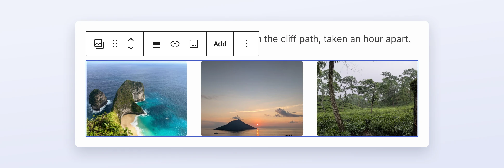
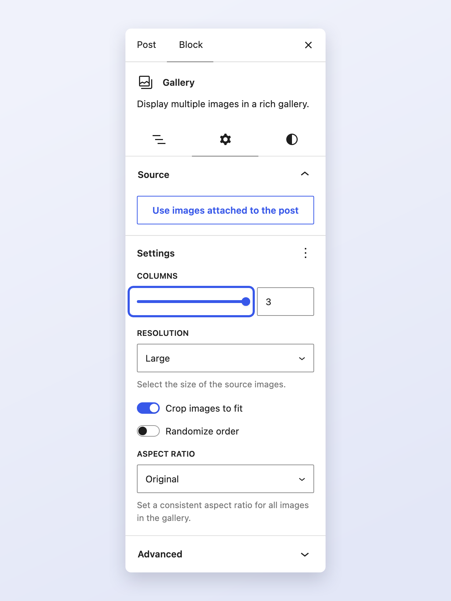

# Gallery block

The Gallery block displays several images in a grid.

## Settings

**Columns** sets how many images sit side by side. The images crop to a uniform size unless you turn off
**Crop images to fit**.

