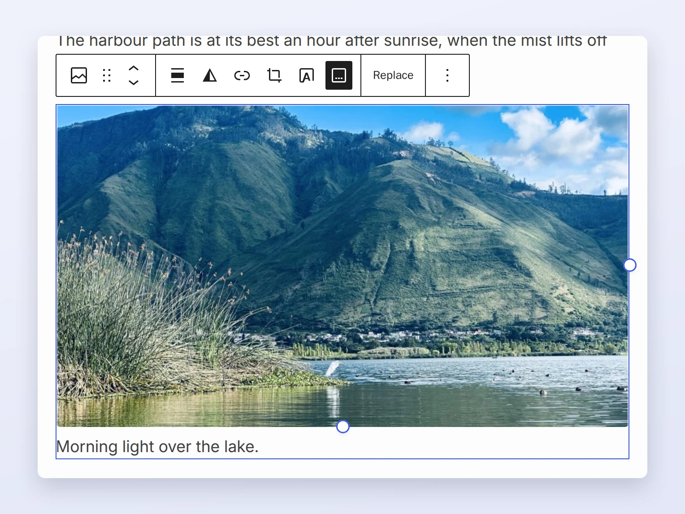
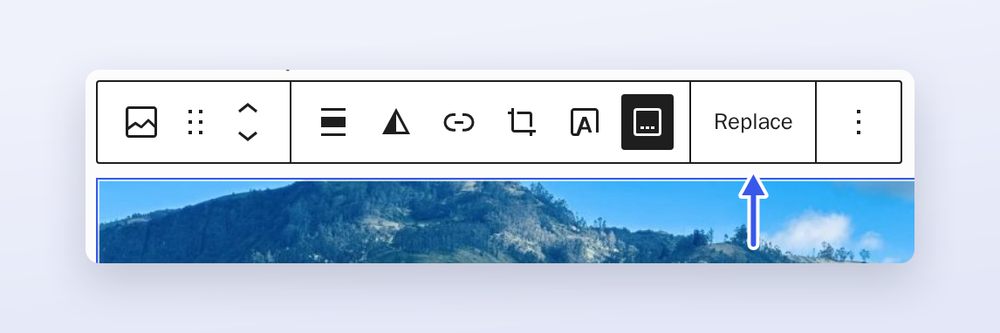
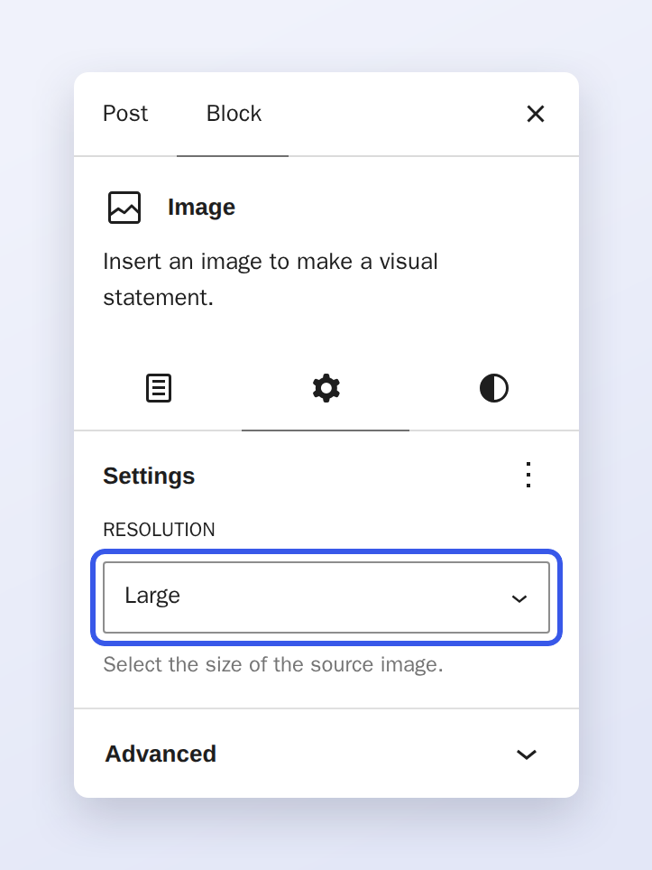
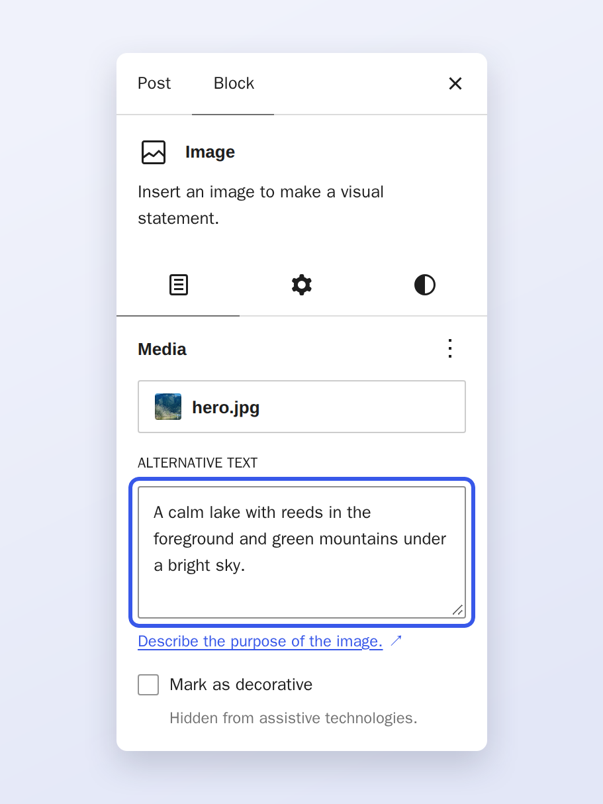

# Image block

The Image block places a single image in your content, with an optional caption.

## Toolbar

Select the block to show its toolbar. Use **Replace** to swap the image for another one from your media library or
a URL.

## Settings

The **Settings** tab controls how the image is sized and linked. **Resolution** picks which generated size of the
image is used.

## Alternative text

Describe the image for people who cannot see it. The field is on the **Content** tab of the block inspector.

