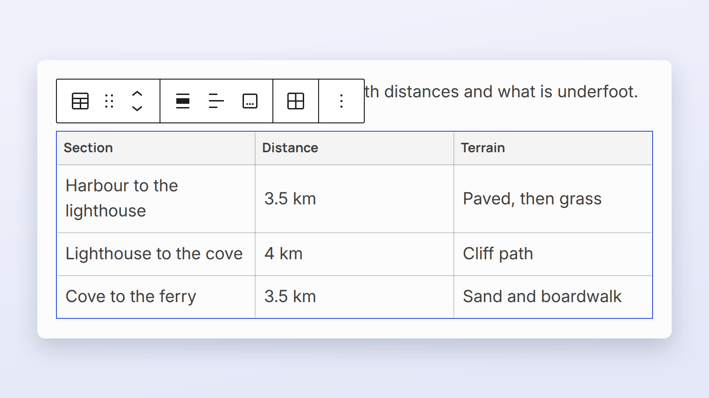
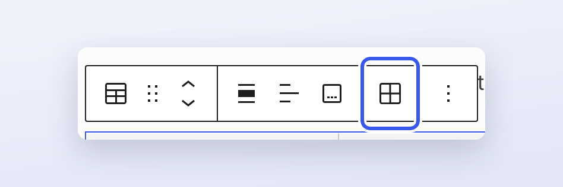
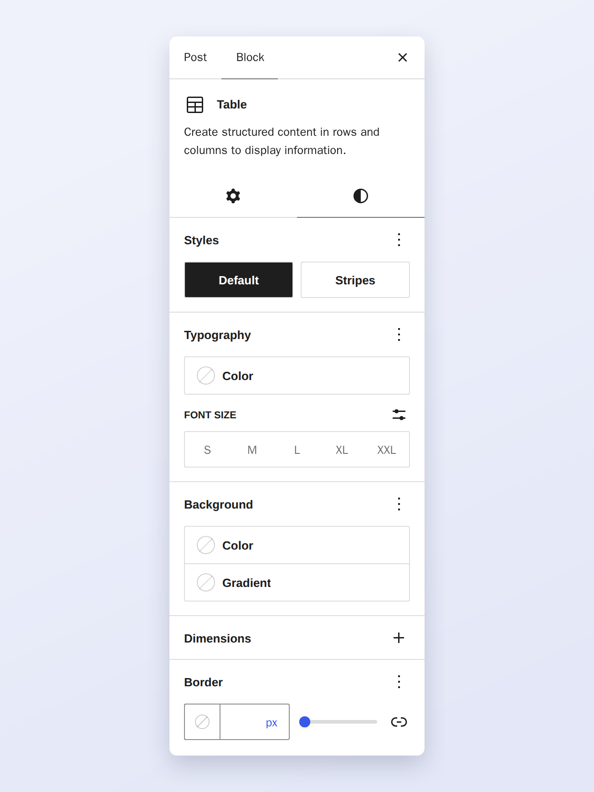

# Table block

The Table block adds a table with a header row, body rows and an optional footer.

## Toolbar

Use **Edit table** to insert or delete rows and columns.

## Styles

The **Styles** tab switches between the **Default** and **Stripes** styles.

