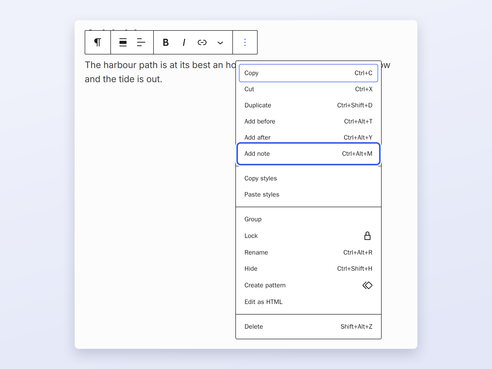
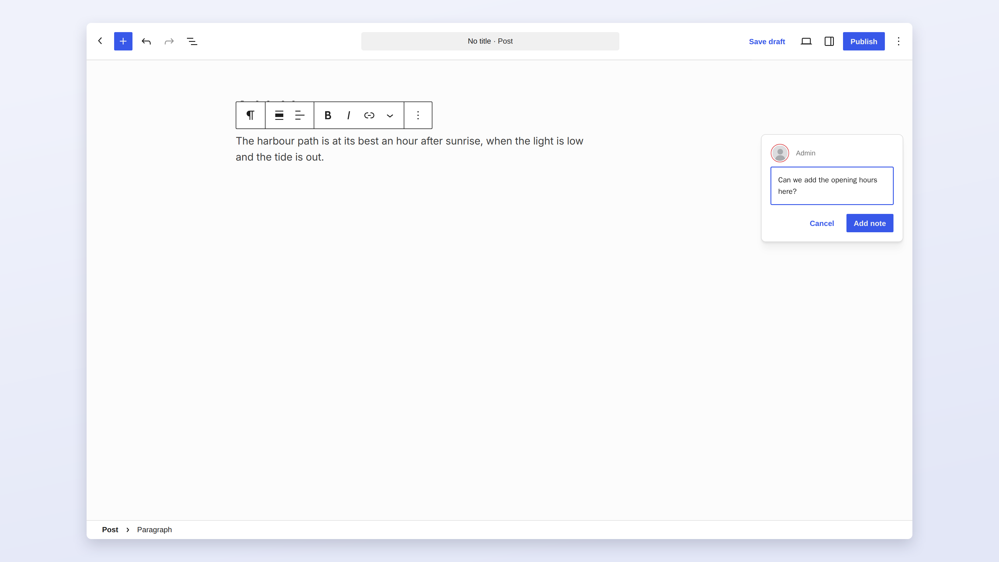
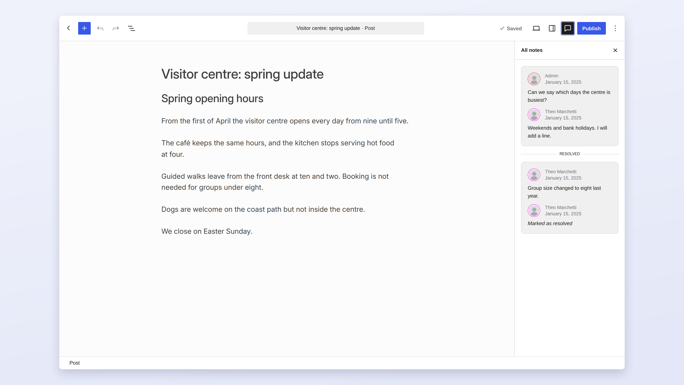
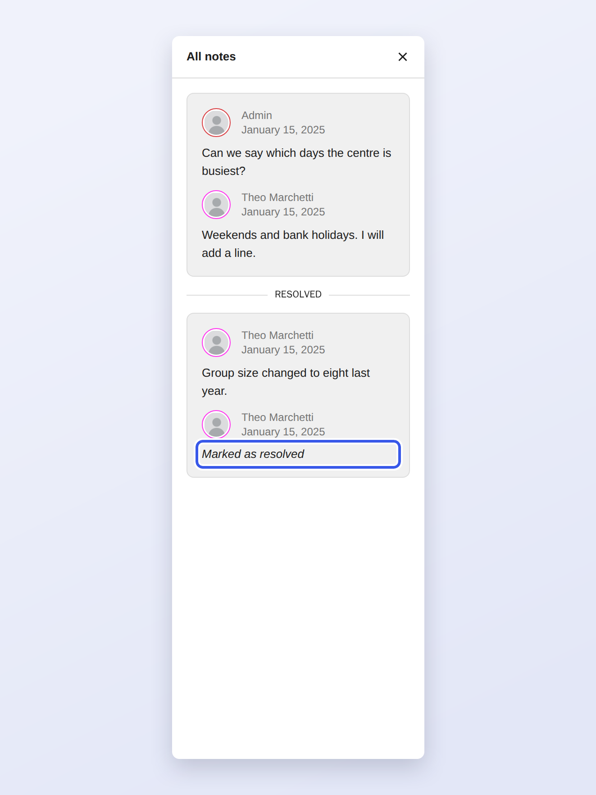

# Notes

Notes let editors and reviewers discuss a post inside the editor, attached to the block they are about. A note starts
from the block's Options menu.

Choosing **Add note** opens a note box next to the block. Type the note and choose **Add note** to save it.

Once a post has notes, the **All notes** button in the top bar opens the Notes sidebar, where every thread is listed
with its replies. Resolved threads move to the bottom of the list.

