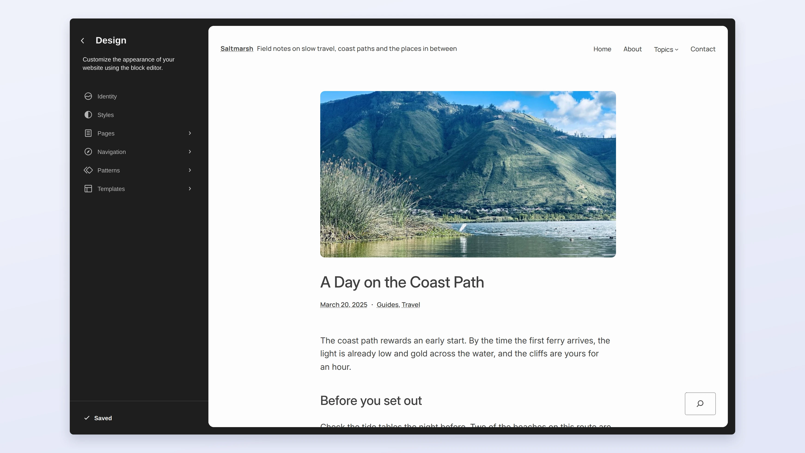
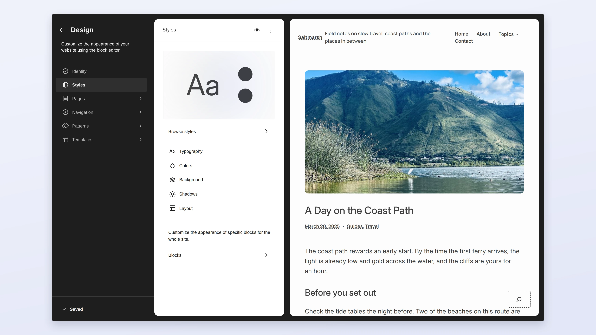

# Site editor

The site editor is where you edit templates, template parts, styles and navigation for a block theme.

## Styles

Open **Styles** to change colors, typography and layout for the whole site.

